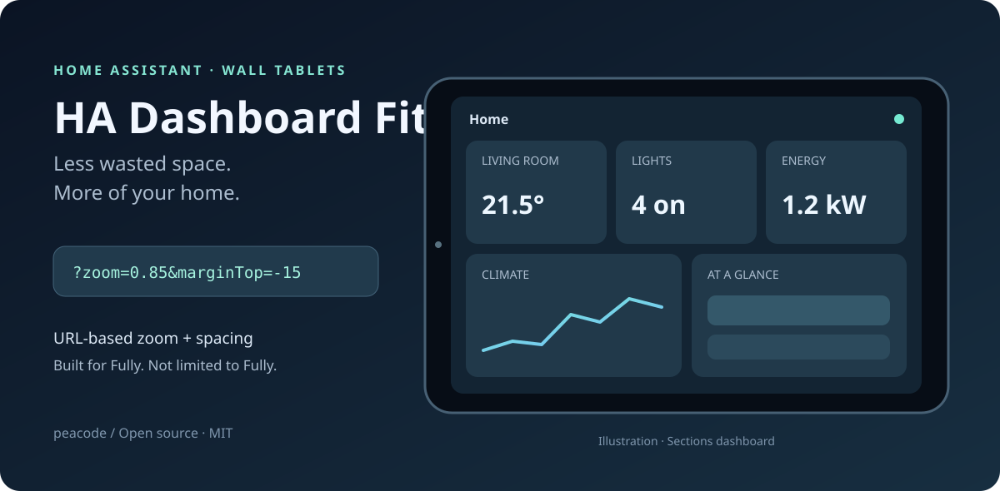

<p align="center">
  
</p>

# HA Dashboard Fit

**Your dashboard. Your tablet. A better fit.**

[Deutsch](docs/README.de.md) · [Releases](https://github.com/peacodecom/ha-dashboard-fit/releases) · [Report an issue](https://github.com/peacodecom/ha-dashboard-fit/issues)



A lightweight Home Assistant frontend module that adjusts **dashboard zoom and
spacing through URL parameters**. Made for an Android wall tablet running
**Fully Kiosk Browser**; not tied to Fully and requires no Fully integration.

For example, `?zoom=0.85&marginTop=-15` scales the dashboard to 85% and shifts the
page upward by 15 CSS pixels. More room for cards, less wasted space above them.
Each device can use its own URL without changing your dashboard configuration.

**Ideal in combination with [Kiosk Mode](https://github.com/NemesisRE/kiosk-mode)**
and its `?kiosk` URL parameter: hide the HA header/sidebar with Kiosk Mode, then
fine-tune zoom and spacing with HA Dashboard Fit. See the combined example below.

> **Experimental v0.1.0.** Supports **Sections, Masonry and Panel views**. It relies on internal
> Home Assistant frontend structure, not a supported HA extension API. Automated
> DOM tests are included; this version has not yet been validated on a
> real tablet. The illustration is not a screenshot.

## Features

- Optional `zoom`, `marginTop` and `marginLeft` URL parameters.
- Scales the dashboard content, not the whole application or HA dialog layer.
- Re-reads options on navigation; restores original inline styles when disabled.
- Handles delayed loading, view replacement and open shadow roots.
- Supports fixed background layers using the `ha-scale` events
  or the `data-ha-scale-fixed` attribute.
- No runtime dependencies, backend integration, telemetry or network requests.

## Install

Install through the Home Assistant Marketplace, HACS or manually.

### Marketplace — Home Assistant 2026.11 and later

1. As an administrator, open **Settings → Marketplace** and accept the
  community-content notice if prompted.
2. Select **Add from link**. Connect your GitHub account if requested.
3. Enter `https://github.com/peacodecom/ha-dashboard-fit` under **GitHub link**
  and select **Add**.
4. If asked for a type, choose **Dashboard** and confirm.
5. Open **HA Dashboard Fit**, select **Install** and confirm the version.
6. The Marketplace normally registers the dashboard resource automatically.
  If resources are managed in YAML, add this entry under `lovelace.resources`:

  ```yaml
  url: /local/community/ha-dashboard-fit/ha-dashboard-fit.js
  type: module
  ```

Reload the frontend, then add your preferred parameters to the dashboard URL
as shown below.

See the official [Marketplace instructions](https://www.home-assistant.io/integrations/marketplace/#custom-repositories).

### HACS — Home Assistant 2026.10 and earlier

1. In HACS, open **Custom repositories**.
2. Add `https://github.com/peacodecom/ha-dashboard-fit` with type
   **Dashboard** (called **Lovelace** or `plugin` in older interfaces).
3. Download **HA Dashboard Fit**.
4. Check **Settings → Dashboards → Resources** (enable Advanced Mode if needed).
   Keep only one resource entry:

   ```yaml
   url: /hacsfiles/ha-dashboard-fit/ha-dashboard-fit.js
   type: module
   ```

If resources are managed in YAML, add that entry to the existing
`lovelace.resources` list instead. Do not create a second `lovelace` key.

### Manual installation

1. Download **ha-dashboard-fit.js** from a GitHub release (or build it locally;
   the ready-to-use file is also in [dist](dist/ha-dashboard-fit.js)).
2. Place it in your Home Assistant configuration's `www` directory.
3. Add a dashboard resource with URL `/local/ha-dashboard-fit.js?v=0.1.0` and
   type **JavaScript module**:

   ```yaml
   url: /local/ha-dashboard-fit.js?v=0.1.0
   type: module
   ```

Reload the frontend after installation. Clear the browser/Fully WebView cache if
necessary. Change the resource's version suffix when updating a manual install.

## Use it on your tablet

Set Fully Kiosk Browser's **Start URL** to your existing HA dashboard/view URL,
with these parameters appended:

```text
https://ha.example.com/dashboard-tablet/home?zoom=0.85&marginTop=-15
```

Replace the example host and dashboard path. If the URL already has a `?`, append
with `&`, for example `?kiosk&zoom=0.85&marginTop=-15`. Put options before any `#`
fragment, not in the resource URL. Existing unrelated parameters are preserved.

| Parameter | Allowed range | Effect |
| --- | --- | --- |
| `zoom` | `0.3`–`3.0` | Dashboard content CSS zoom; `0.85` = 85%, `1` = 100%. |
| `marginTop` | `-500`–`500` | Body top margin in CSS pixels; `-15` shifts upward. |
| `marginLeft` | `-500`–`500` | Content target's left margin in CSS pixels. |

All parameters are optional and case-sensitive. Use decimal **points**, not
commas. Empty, invalid and out-of-range values are ignored. The first value wins
if a parameter is repeated. Removing the options restores the previous inline
styles; an unparameterized desktop URL is unaffected. Values are not stored.

This is **not kiosk mode**: it does not hide the header/sidebar, change Fully's
settings, bypass login or adjust Android screen density. Negative offsets can
clip content; smaller zoom makes touch targets smaller. Start with gentle values.

### Recommended: combine with Kiosk Mode

Install [Kiosk Mode by NemesisRE](https://github.com/NemesisRE/kiosk-mode)
separately, following its installation instructions, then use this Fully Start URL:

```text
https://ha.example.com/dashboard-tablet/home?kiosk&zoom=0.85&marginTop=-15
```

- `kiosk` is handled by **Kiosk Mode** to hide the HA header and sidebar.
- `zoom=0.85` and `marginTop=-15` are handled by **HA Dashboard Fit**.

Kiosk Mode is optional and independent of the **Fully Kiosk Browser** Android app.
The `?kiosk` parameter alone does not install or enable either project. Refer to
Kiosk Mode's documentation for its configuration, exceptions and exit options.
This is a recommended setup, not a claim of automated third-party compatibility
testing; validate the combination on your tablet.

## Supported layouts and elements

| View / element | Supported | Scaled content |
| --- | --- | --- |
| **Sections** (`type: sections`) | Yes | `div.wrapper` inside `hui-sections-view`, including its view header, badges and sections. |
| **Masonry** (`type: masonry`, or the default cards view) | Yes | `hui-masonry-view` itself, including badges and all card columns. |
| **Panel** (`type: panel`) | Yes | `hui-panel-view` itself, including its panel card. |
| Standard and custom cards inside these targets | Inherited | Cards scale with their parent; no individual card-type registration is needed. |
| Subviews | Same layout rules | Supported when rendered as one of the three layouts above. |
| Fixed background layers | Opt-in | Inverse zoom through `data-ha-scale-fixed` or the fixed-layer events. |
| HA app header, sidebar and dialogs outside the content target | Not zoomed | Deliberately excluded from dashboard zoom. |
| Sidebar layout, custom view layouts, other HA panels and add-on ingress | No | No matching zoom target is selected. |

These are **dashboard view types**, not individual `grid`, `entities`, `tile` or
other card types. A `grid` card inside a Masonry view still uses the Masonry zoom
target. Panel view here means the Lovelace layout, not arbitrary HA panels.

### Compatibility and limitations

- A current browser/WebView with **CSS `zoom`** support is required (for example
  Chromium/Android WebView 120+). Browser minimums are not device certification.
- Only the listed built-in view layouts are targeted; unknown layouts are not
  guessed or replaced with whole-page zoom.
- Home Assistant dialogs outside the content target are deliberately not scaled.
  Card-local dialogs and third-party overlays may behave differently.
- Header/sidebar remain unscaled; `marginTop` offsets the body while a supported
  view is active. Scaling can affect responsive breakpoints and scrolling.
- Masonry chooses its column count using viewport media queries; reducing zoom
  does not necessarily add more columns. Panel cards can have their own sizing
  constraints, so shrinking them may leave free space.
- There is no guarantee for every HA frontend version or third-party card.
  See [validation status](docs/validation.md).

## Troubleshooting and removal

See the [usage and integration guide](docs/usage.md) for fixed-layer integration,
cache troubleshooting and complete removal.

## Development

Node.js 24 or newer: `npm ci`, `npm run check`, then
`npm audit --audit-level=low`. `dist/ha-dashboard-fit.js` is the self-contained
release asset. Source and tests are not needed on Home Assistant.

[Contributing](CONTRIBUTING.md) · [Release process](docs/releasing.md) ·
[Changelog](CHANGELOG.md) · [Security](SECURITY.md)

## License and credits

[MIT](LICENSE) · Copyright © 2026 [Norman Bauer](https://github.com/norman-bauer).
Published by [peacode](https://peacode.com), a registered trademark.
The software license does not grant trademark rights. See [AUTHORS](AUTHORS.md).
Not affiliated with Home Assistant or Fully Kiosk Browser.
