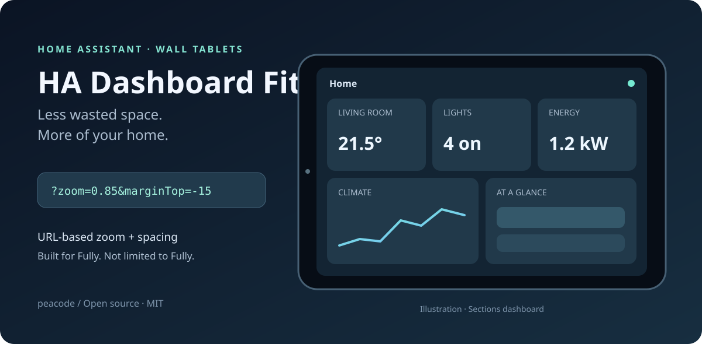

<p align="center">
  
</p>

# HA Dashboard Fit

**Dein Dashboard. Dein Tablet. Passend gemacht.**

[English](../README.md) · [Releases](https://github.com/peacodecom/ha-dashboard-fit/releases) · [Fehler melden](https://github.com/peacodecom/ha-dashboard-fit/issues)



Ein schlankes Frontend-Modul für Home Assistant: **Dashboard-Zoom und Abstände
per URL einstellen**, ohne das Dashboard für alle Geräte umzubauen.
Entstanden für ein Android-Wandtablet mit **Fully Kiosk Browser**. Es funktioniert
auch ohne Fully; eine Fully-Integration wird nicht benötigt.

`?zoom=0.85&marginTop=-15` verkleinert das Dashboard auf 85 % und verschiebt die
Seite um 15 CSS-Pixel nach oben. So passen mehr Karten auf den Bildschirm und
der obere Abstand wird kleiner. Jedes Gerät kann seine eigene URL verwenden.

**Ideal in Verwendung mit [Kiosk Mode](https://github.com/NemesisRE/kiosk-mode)**
und dessen URL-Parameter `?kiosk`: Kiosk Mode blendet HA-Kopfzeile und Seitenleiste
aus, HA Dashboard Fit passt Zoom und Abstände an. Kombiniertes Beispiel unten.

> Unterstützt **Sections-, Masonry- und Panel-Ansichten**. Installation und
> Dashboard-Skalierung wurden im Setup des Maintainers erfolgreich getestet.
> Das Modul nutzt interne HA-Frontend-Strukturen, keine stabile
> HA-Erweiterungsschnittstelle. Offene Prüfpunkte stehen im
> [Prüfstatus](validation.md).
> Das Bild ist eine Illustration, kein Screenshot.

## Funktionen

- Optionale URL-Parameter `zoom`, `marginTop` und `marginLeft`.
- Zoom nur auf dem Dashboard-Inhalt, nicht auf der ganzen Anwendung.
- HA-Dialoge außerhalb des Inhaltsbereichs bleiben unskaliert.
- URL-Werte werden bei Navigation neu gelesen; entfernte Parameter setzen die
  zuvor vorhandenen Inline-Styles zurück.
- Unterstützt verzögertes Laden, Ansichtswechsel und offene Shadow Roots.
- Unterstützt feste Hintergrundebenen über die `ha-scale`-Events
  oder das Attribut `data-ha-scale-fixed`.
- Keine Laufzeit-Abhängigkeiten, Backend-Integration, Telemetrie oder Netzabrufe.

## Installation

Die Installation erfolgt über den Home Assistant Marketplace, HACS oder manuell.

### Marketplace — Home Assistant ab 2026.11

1. Als Administrator **Einstellungen → Marketplace** öffnen und gegebenenfalls
  den Hinweis zu Community-Inhalten bestätigen.
2. **Über Link hinzufügen** wählen. Falls angefordert, das GitHub-Konto verbinden.
3. Unter **GitHub-Link** `https://github.com/peacodecom/ha-dashboard-fit`
  eingeben und **Hinzufügen** wählen.
4. Bei der Typauswahl **Dashboard** wählen und bestätigen.
5. **HA Dashboard Fit** öffnen, **Installieren** wählen und die Version bestätigen.
6. Der Marketplace registriert die Dashboard-Ressource normalerweise automatisch.
  Bei YAML-verwalteten Ressourcen diesen Eintrag unter `lovelace.resources`
  ergänzen:

  ```yaml
  url: /local/community/ha-dashboard-fit/ha-dashboard-fit.js
  type: module
  ```

Das Frontend neu laden und anschließend die gewünschten Parameter an die
Dashboard-URL anhängen, wie unten gezeigt.

Offizielle [Marketplace-Anleitung](https://www.home-assistant.io/integrations/marketplace/#custom-repositories).

### HACS — Home Assistant bis einschließlich 2026.10

1. In HACS **Benutzerdefinierte Repositories** öffnen.
2. `https://github.com/peacodecom/ha-dashboard-fit` mit Typ **Dashboard**
   hinzufügen (ältere Oberflächen: **Lovelace** beziehungsweise `plugin`).
3. **HA Dashboard Fit** herunterladen.
4. Unter **Einstellungen → Dashboards → Ressourcen** kontrollieren, bei Bedarf
   den erweiterten Modus aktivieren. Die Ressource nur einmal eintragen:

   ```yaml
   url: /hacsfiles/ha-dashboard-fit/ha-dashboard-fit.js
   type: module
   ```

Bei YAML-verwalteten Ressourcen diesen Eintrag in die bestehende Liste
`lovelace.resources` aufnehmen, keinen zweiten `lovelace`-Schlüssel anlegen.

### Manuell

1. **ha-dashboard-fit.js** aus einem Release herunterladen oder selbst bauen.
   Die fertige Datei liegt auch unter [dist](../dist/ha-dashboard-fit.js).
2. In den Ordner `www` der Home-Assistant-Konfiguration kopieren.
3. Dashboard-Ressource mit URL `/local/ha-dashboard-fit.js?v=0.1.0` und Typ
   **JavaScript-Modul** hinzufügen:

   ```yaml
   url: /local/ha-dashboard-fit.js?v=0.1.0
   type: module
   ```

Danach das Frontend neu laden. Bei Bedarf den Browser-/Fully-WebView-Cache leeren.
Bei manuellen Updates den Versionszusatz der Ressourcen-URL ändern.

## Beispiel für Fully Kiosk Browser

Als **Start URL** die bisherige Dashboard-/Ansichtsadresse mit Parametern setzen:

```text
https://ha.example.com/dashboard-tablet/home?zoom=0.85&marginTop=-15
```

Beispielhost und Dashboardpfad ersetzen. Enthält die URL schon ein `?`, die
Parameter mit `&` ergänzen: `?kiosk&zoom=0.85&marginTop=-15`.
Parameter gehören vor ein eventuelles `#`-Fragment und in die Dashboard-URL,
**nicht** in die Ressourcen-URL.

| Parameter | Wertebereich | Wirkung |
| --- | --- | --- |
| `zoom` | `0.3`–`3.0` | CSS-Zoom des Dashboard-Inhalts; `0.85` = 85 %, `1` = 100 %. |
| `marginTop` | `-500`–`500` | Oberer Body-Abstand in CSS-Pixeln; `-15` verschiebt nach oben. |
| `marginLeft` | `-500`–`500` | Linker Abstand des Inhaltsziels in CSS-Pixeln. |

Alle Parameter sind optional, Groß-/Kleinschreibung beachten. Dezimalzahlen mit
**Punkt**, nicht mit Komma schreiben. Leere, ungültige oder zu große/kleine Werte
werden ignoriert. Bei mehrfach vorhandenen Parametern zählt der erste Wert.
Ohne Parameter werden die vorherigen Inline-Styles wiederhergestellt; ein
Desktop-Aufruf ohne Parameter bleibt unverändert. Werte werden nicht gespeichert.

Das Modul ist **kein Kiosk-Modus**: Es versteckt weder Kopfzeile noch Seitenleiste,
ändert keine Fully-Einstellungen oder Android-Pixeldichte und umgeht keine
Anmeldung. Negative Abstände können Inhalte abschneiden; kleine Zoomwerte
verkleinern auch die Touch-Ziele.

### Empfehlung: zusammen mit Kiosk Mode verwenden

[Kiosk Mode von NemesisRE](https://github.com/NemesisRE/kiosk-mode) separat nach
dessen Anleitung installieren. Anschließend diese kombinierte Fully-Start-URL
verwenden:

```text
https://ha.example.com/dashboard-tablet/home?kiosk&zoom=0.85&marginTop=-15
```

- `kiosk` wird von **Kiosk Mode** ausgewertet und versteckt HA-Kopfzeile und
  Seitenleiste.
- `zoom=0.85` und `marginTop=-15` werden von **HA Dashboard Fit** ausgewertet.

Kiosk Mode ist optional und unabhängig von der Android-App **Fully Kiosk Browser**.
Der Parameter `?kiosk` allein installiert oder aktiviert keines der Projekte.
Konfiguration, Ausnahmen und Ausstiegsmöglichkeiten stehen in der Kiosk-Mode-
Dokumentation. Diese Empfehlung ersetzt keinen Test der Kombination auf dem
eigenen Tablet; automatisierte Drittanbieter-Kompatibilitätstests fehlen noch.

## Unterstützte Layouts und Elemente

| Ansicht / Element | Unterstützt | Skalierter Inhalt |
| --- | --- | --- |
| **Sections / Abschnitte** (`type: sections`) | Ja | `div.wrapper` in `hui-sections-view`, einschließlich Ansichtskopf, Badges und Abschnitten. |
| **Masonry** (`type: masonry` oder Standard-Kartenansicht) | Ja | `hui-masonry-view` selbst, einschließlich Badges und aller Kartenspalten. |
| **Panel** (`type: panel`) | Ja | `hui-panel-view` selbst, einschließlich der Panel-Karte. |
| Standard- und Custom-Karten innerhalb dieser Ziele | Vererbt | Karten werden mit dem übergeordneten Bereich skaliert; keine Registrierung einzelner Kartentypen nötig. |
| Unteransichten / Subviews | Gleiche Layoutregeln | Unterstützt, wenn eines der drei obigen Layouts verwendet wird. |
| Feste Hintergrundebenen | Opt-in | Inverser Zoom über `data-ha-scale-fixed` oder die Fixed-Layer-Events. |
| HA-App-Kopfzeile, Seitenleiste und Dialoge außerhalb des Inhaltsziels | Kein Zoom | Bewusst vom Dashboard-Zoom ausgenommen. |
| Sidebar-Layout, eigene Ansichts-Layouts, andere HA-Panels und Add-on-Ingress | Nein | Kein passendes Zoom-Ziel wird ausgewählt. |

Gemeint sind **Ansichtstypen**, nicht einzelne Karten wie `grid`, `entities` oder
`tile`. Eine `grid`-Karte in einer Masonry-Ansicht verwendet weiterhin das
Masonry-Zoom-Ziel. Panel bezeichnet hier das Lovelace-Layout, nicht beliebige
HA-Panels.

### Grenzen

- Aktueller Browser/WebView mit **CSS-`zoom`**, beispielsweise Chromium/Android
  WebView 120+. Das ist keine Zusicherung für ein bestimmtes Gerät.
- Nur die genannten eingebauten Ansichtstypen werden gezielt unterstützt.
  Unbekannte Layouts werden nicht geraten oder durch Ganzseiten-Zoom ersetzt.
- Karteninterne Dialoge und Drittanbieter-Overlays können sich anders verhalten
  als HA-Dialoge außerhalb des Inhaltsziels.
- Kopfzeile und Seitenleiste bleiben unskaliert. `marginTop` verschiebt den Body,
  solange eine unterstützte Ansicht aktiv ist. Breakpoints und Scrollverhalten
  können sich ändern.
- Masonry bestimmt die Spaltenzahl über Viewport-Media-Queries. Ein kleinerer
  Zoom erzeugt deshalb nicht zwingend zusätzliche Spalten. Panel-Karten können
  eigene Größenregeln haben, sodass beim Verkleinern freie Fläche entsteht.
- HA-Frontend-Updates können Anpassungen nötig machen. Den tatsächlichen
  [Prüfstatus](validation.md) beachten.

## Fehlerbehebung und Deinstallation

Bei Problemen zuerst Ressourcendownload und Modultyp, unterstützten Ansichtstyp,
Dezimalpunkt und aktuelle WebView-Version prüfen. Dann ohne andere
Zoom-/Kiosk-Erweiterungen testen. Vollständige Frontend-Neuladung nicht vergessen.

Zum Deaktivieren die URL-Parameter entfernen. Zum Entfernen zusätzlich die
Ressource und Marketplace-/HACS-Installation beziehungsweise manuelle Datei löschen und das
Frontend neu laden. Details zur Hintergrund-API stehen in der englischen
[Integrationsanleitung](usage.md).

## Entwicklung und Lizenz

Node.js 24 oder neuer: `npm ci`, `npm run check`,
`npm audit --audit-level=low`. Fertige Einzeldatei: `dist/ha-dashboard-fit.js`.
Quellcode und Tests müssen nicht auf Home Assistant installiert werden.

[MIT-Lizenz](../LICENSE) · Copyright © 2026
[Norman Bauer](https://github.com/norman-bauer) · Veröffentlicht von
[peacode](https://peacode.com), einer eingetragenen Marke.
Die Softwarelizenz gewährt keine Markenrechte. Keine Verbindung zu Home Assistant
oder Fully Kiosk Browser. [Mitwirken](../CONTRIBUTING.md) ·
[Änderungen](../CHANGELOG.md) · [Sicherheit](../SECURITY.md).
